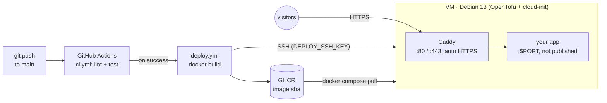

<div align="center">

# vauban

**Point it at a repo, answer three questions, push. Set up once, never think about it again.**

CI, a container image, a hardened VM with automatic HTTPS and the GitHub deploy wiring, from one command.

[](https://github.com/jean-baptisteAZAN/vauban/actions/workflows/ci.yml)
[](https://github.com/jean-baptisteAZAN/vauban/releases)
[](go.mod)
[](LICENSE)
[](https://goreportcard.com/report/github.com/jean-baptisteAZAN/vauban)


<sub>Demo runs against fake tofu/gh — no real VM created (cloud API calls are stubbed too; see <a href="docs/demo/setup.sh">docs/demo</a>).</sub>

</div>

vauban is a fast, single-binary Go CLI. It looks at your repository (Go, Node/TypeScript or Python), shows what is missing to ship it, and in one `vauban apply` sets up a Dockerfile, GitHub Actions CI, an OpenTofu-managed Debian 13 VM on Scaleway, DigitalOcean or Hetzner, Caddy with automatic HTTPS, a GHCR + SSH deploy workflow and the GitHub secrets that tie it all together. Then every push to `main` ships.

## Contents

- [Why vauban](#why-vauban)
- [Features](#features)
- [Install](#install)
- [Quickstart](#quickstart)
- [How it works](#how-it-works)
- [What gets created](#what-gets-created)
- [Supported clouds and stacks](#supported-clouds-and-stacks)
- [Security defaults](#security-defaults)
- [Safety and exit codes](#safety-and-exit-codes)
- [Use your own server](#use-your-own-server)
- [Destroy](#destroy)
- [Known limitations](#known-limitations)
- [Performance](#performance)
- [Roadmap](#roadmap)
- [Contributing](#contributing)
- [License](#license)

## Why vauban

Shipping a small app should be a one-time chore, not a hobby.

- **Delegate to the official tools.** vauban does not carry a pile of hand-written templates or its own cloud client. It drives `docker`, `tofu`, `gh`, `ssh-keygen` and the cloud providers' official Terraform providers, and your infrastructure stays as reviewable OpenTofu code in your repo.
- **Wire them together.** Its own job is the glue: Terraform outputs into CI, SSH keys where each side needs them, secrets into GitHub.
- **Safe by default.** Nothing is written or run without appearing in `vauban plan` first, existing files are never overwritten, destroying anything needs the project name typed, and every default favours a setup that runs unattended: automatic TLS, automatic security updates, automatic restarts.

*The name: [Vauban](https://en.wikipedia.org/wiki/S%C3%A9bastien_Le_Prestre_de_Vauban) was Louis XIV's military engineer, who fortified sites with a standard system adapted to each terrain.*

## Features

- 🔍 **Detects your stack**: Go, Node/TypeScript or Python, the package manager, existing Dockerfile, workflows, lint and test config, the GitHub remote.
- 🧾 **Plans before it acts**: `vauban plan` lists every file it will write and every command it will run.
- 🐳 **Container image**: a multi-stage Dockerfile for your stack.
- ✅ **CI**: lint and tests with the tooling your repo already has.
- 🏰 **Hardened VM**: Debian 13 on Scaleway, DigitalOcean or Hetzner, managed with OpenTofu, locked down with cloud-init.
- 🔒 **Automatic HTTPS**: Caddy in front of your app, on your domain or on `<ip>.sslip.io` with zero DNS setup.
- 🚀 **Push to deploy**: image built and pushed to GHCR, deployed over SSH by immutable commit sha.
- 🔑 **GitHub wiring**: deploy key generated and `DEPLOY_*` secrets set through `gh`.
- ♻️ **Idempotent and resumable**: run `apply` twice and nothing changes; interrupt it and it picks up where it stopped.
- ⚡ **Lightweight**: one 17 MB binary, `doctor` answers in about 5 ms.

## Install

```sh
# Homebrew (macOS)
brew install jean-baptisteAZAN/tap/vauban

# Go
go install github.com/jean-baptisteAZAN/vauban@latest

# Or grab a binary (macOS and Linux, amd64 and arm64) from
# https://github.com/jean-baptisteAZAN/vauban/releases
```

vauban uses `gh`, `tofu` (or `terraform`), `docker` and `ssh-keygen` when present and reports the missing ones; it never installs anything.

## Quickstart

```sh
vauban doctor   # report: stack detected, what is missing, which tools are installed (bare `vauban` is an alias)
vauban plan     # pick cloud/region/size, see every file and command; only saves vauban.yaml
vauban apply    # confirm, then write files, create the VM, push GitHub secrets
git add -A && git commit -m "ship it" && git push   # vauban never pushes for you
```

vauban deploys from GitHub Actions, so `plan` and `apply` first check for a GitHub `origin` remote and stop (exit 1) before asking anything if there is none, printing the `gh repo create <name> --private --source . --push` command to create one, preceded, when the repo has no commit yet, by the first commit it needs (`git add -A && git commit -m "init"`; check that `.gitignore` covers `.env` and secrets first). `doctor` suggests the same commands as its next step.

`plan` and `apply` save your answers to `vauban.yaml` (commit it) as soon as they are complete and valid, so they are kept even if the plan then fails. A cloud change refused because servers are applied is never saved, and `destroy` always uses the cloud the infra was applied on. After that `plan` and `apply` are non-interactive and reproducible. Without a terminal, pass `--yes` to `apply` (and `--cloud` if there is no `vauban.yaml`). Anything that destroys or replaces cloud resources needs the project name typed in a terminal, or `--confirm <project>` (`apply` and `destroy`).

Useful flags: `--cloud scaleway|digitalocean|hetzner`, `--region`, `--size`, `--domain`, `--port`, `--reconfigure`, `--force` (overwrite generated files only), `--confirm <project>`, `--dir <path>`. Every command has `--help`.

## How it works

1. **`doctor`** scans the repo on disk (no network): stack, what exists, what is missing, which tools are installed.
2. **`plan`** asks for cloud, region, size, domain and port (regions and sizes come from the cloud's API), saves `vauban.yaml`, and prints every file and command `apply` would run. Nothing else changes.
3. **`apply`** checks everything up front (GitHub remote, `gh` login, `tofu`, `ssh-keygen`, cloud credentials, the account quota for a new server), asks for confirmation, then writes the files, generates the deploy key, runs `tofu init/plan/apply`, reads the server IP from `tofu output` and sets the GitHub secrets.

After that, vauban is out of the loop: your next `git push` does the rest.



## What gets created

| Path | What |
|---|---|
| `Dockerfile` (+ `.dockerignore`) | Multi-stage image for your stack |
| `.github/workflows/ci.yml` | Lint and tests with the tooling your repo already has |
| `infra/` | OpenTofu code for the VM and its firewall, plus the cloud-init script that installs the deploy key for the `deploy` user (on DigitalOcean and Hetzner the key is also registered as a cloud SSH key) |
| `deploy/compose.yaml`, `deploy/Caddyfile` | Caddy (automatic HTTPS) in front of your app, both `restart: unless-stopped` |
| `.github/workflows/deploy.yml` | Builds and pushes the image to GHCR, then deploys over SSH |
| GitHub secrets | `DEPLOY_HOST`, `DEPLOY_SSH_KEY`, `DEPLOY_DOMAIN`, set through `gh` |

Existing files are never overwritten: they are reported as `skip (exists)` unless you pass `--force`. Every file and command appears in `vauban plan` before `apply` does it. Changing `app_port` later therefore needs `vauban apply --force` to regenerate the deploy files; when only files, the domain or secrets change, `apply` ends with `push to redeploy`.

Without a domain, HTTPS works out of the box on `<ip>.sslip.io`. With one (`--domain`), `apply` prints the DNS records to create once the server exists: an A record to its IPv4 and, when it has one, an AAAA record to its IPv6. App secrets: add a GitHub secret named `APP_<NAME>` and the deploy job writes `<NAME>` into `~/app/.env` on the VM (mode 600).

## Supported clouds and stacks

Stacks: **Go**, **Node/TypeScript**, **Python**. Your app must listen on `0.0.0.0:$PORT`: vauban sets `PORT` to `app_port` in the container.

| Cloud | Credentials (first match wins) |
|---|---|
| Scaleway | `SCW_ACCESS_KEY`, `SCW_SECRET_KEY`, `SCW_DEFAULT_PROJECT_ID`, else the active profile in `~/.config/scw/config.yaml` |
| DigitalOcean | `DIGITALOCEAN_TOKEN`, else the `doctl` config |
| Hetzner | `HCLOUD_TOKEN`, else `~/.config/hcloud/cli.toml` |

Node: the `start` script must not call pnpm, yarn or bun: the image runs `npm start`.

### Quotas

A size the cloud lists as available can still be refused by your account's quota. vauban checks before it creates a server:

| Cloud | What is checked |
|---|---|
| Scaleway | The organization's per-type quota (`cp_servers_type_<TYPE>` per zone, IAM `GET /iam/v1alpha1/quota`) against the servers of that type in the zone (Instance dashboard). The size picker leaves out types whose quota is 0. Reading quotas needs an API key allowed to read the organization's quotas; without that permission (or without `SCW_DEFAULT_ORGANIZATION_ID` / a readable project), quotas are not checked. |
| DigitalOcean | The account `droplet_limit` (`GET /v2/account`) against the number of droplets. Resizing or replacing an applied droplet adds none, so it is only refused when the account is already over the limit. |
| Hetzner | Not checked: the Hetzner Cloud API does not expose project limits. |

When a new server would be created, `apply`'s preflight fails before any step if the quota is exhausted, e.g. `scaleway: quota for STARDUST1-S in fr-par-1 is 0 — pick another size (vauban plan --size …) or request a quota increase at https://console.scaleway.com/organization/quotas`; `plan` shows the same under `before apply:`. If `tofu apply` is still refused for a quota or limit, the error ends with the same advice.

Quota uncertainty never blocks: when the quota API fails (server error, rate limit, timeout; each check has its own 10 s limit), `plan` and `apply` warn `quota not checked: …` and go on; a cloud that cannot report quotas (Hetzner, or a Scaleway key without quota access) gets a `note:` line. When resuming an interrupted first apply (resources may already exist), an exhausted quota is a warning, not a failure; tofu remains the backstop.

GitHub access comes from `gh auth login`. vauban stores no credentials itself.

> [!TIP]
> The `DEPLOY_*` secrets are repository secrets. To restrict them to deploys from `main`, move them to a GitHub Environment with a branch protection rule and set `environment:` on the deploy job.

## Security defaults

- Debian 13 VM, non-root `deploy` user, `PermitRootLogin no`, `PasswordAuthentication no`.
- The cloud firewall is the perimeter: tcp 22, 80, 443 and udp 443 (HTTP/3) only. `ufw` on the VM is defense in depth for host services, since Docker-published ports bypass it.
- Unattended security upgrades with a night-time reboot, Docker log rotation, a daily image prune.
- The app is not published on the host; only Caddy can reach it.
- When a CI workflow exists, deploys only run after it succeeds on a push to this repository (pull requests and forks cannot deploy); without one, deploy runs on every push to `main`.
- Images are deployed by immutable commit sha, never `latest`.
- Changes that destroy or replace cloud resources need the project name typed (or `--confirm <project>`); `--yes` and `--force` never approve them.
- No secret value is printed, logged, or written to the repo or to `.vauban/state.json`. The deploy key lives at `~/.ssh/vauban_<project>_ed25519` (0600).

Found a vulnerability? See [SECURITY.md](SECURITY.md).

## Safety and exit codes

`apply` is idempotent and resumable: running it twice changes nothing, and an interrupted run picks up where it stopped. Ctrl-C stops cleanly, tells you to rerun `vauban apply`, and exits 130.

| Code | Meaning |
|---|---|
| 0 | Success |
| 1 | Failure, including no GitHub remote or a failed preflight (nothing was applied) |
| 2 | Usage problem: `apply` without a terminal and without `--yes`, or with a mismatched `--confirm`; `destroy` without a terminal and without `--confirm <project>` (or a mismatched name); `plan` with no `vauban.yaml` and no `--cloud` outside a terminal |
| 3 | Destructive infra change not confirmed (nothing was applied): rerun and type the project name, or pass `--confirm <project>` |
| 130 | Interrupted (Ctrl-C); state is kept, rerun to resume |

## Use your own server

Already have a Debian or Ubuntu machine? Point vauban at it instead of creating a VM:

```yaml
# vauban.yaml
project: shop
target: existing
domain: shop.example.com     # required in this mode
app_port: 8080
server:
  host: 203.0.113.10         # IP or hostname
  port: 22                   # optional, default 22
  user: ops                  # the SSH user vauban connects as
  key: ~/.ssh/id_ed25519     # a private key path, or the literal "agent"
```

Or pass `--target existing --host <ip> --ssh-user <user> --ssh-key <path|agent> [--ssh-port <n>]` to `vauban plan`. `cloud`, `region` and `size` must stay empty in this mode.

### Audit first

```sh
vauban audit
```

`audit` is read-only: it runs a script over SSH that writes nothing and only calls `sudo -n true` and `sudo -n sshd -T` as sudo. It reports the OS, sudo, Docker and Compose, the `deploy` user, the ports 80/443, any Caddy found, the firewall, SSH password login, free disk and pending updates, and says what `apply` would do or why it would stop. `plan` and `apply` run the same audit first and stop before any change if it finds a blocker. The first connection pins the host key in `.vauban/known_hosts`; if it later changes, vauban stops and tells you to remove the line yourself if the change is expected.

### What `apply` installs, and what it needs

| What | When | Needs |
|---|---|---|
| Docker Engine + Compose plugin | only if missing (Compose alone if only Compose is missing) | passwordless `sudo` |
| User `deploy`, in the `docker` group, no sudo | only if missing | passwordless `sudo` |
| The project's deploy key in `~deploy/.ssh/authorized_keys`, as a line ending ` # vauban:<project>` | each project | `sudo`, or connecting as `deploy` |
| Docker network `vauban` | if missing | `sudo`, or an SSH user in the `docker` group, or `deploy` |
| `vauban-caddy` (`caddy:2`, `restart: unless-stopped`) in `/opt/vauban/caddy` | only when nothing listens on 80/443 | passwordless `sudo` |
| `~deploy/apps/<project>/` with an owner marker, and `<sites dir>/<project>.caddy` | each project | `sudo`, or connecting as `deploy` |

If everything that is missing needs `sudo` and your user has none, `apply` stops and says what to install by hand. On a server that is already fully set up, `apply` works without `sudo` when you connect as `deploy`. Only Debian and Ubuntu (`ID` or `ID_LIKE` containing `debian`) are supported for installs.

`deploy` is in the `docker` group, which is root-equivalent on that machine. There is one `deploy` user per server, shared by every vauban project on it.

### Caddy

- Nothing on 80/443: vauban installs its own Caddy in `/opt/vauban/caddy`. Its Caddyfile is exactly `import /etc/caddy/sites/*.caddy`, and each project adds one file to `sites/`:

  ```
  shop.example.com {
  	reverse_proxy shop-app:8080
  }
  ```

- You already run Caddy in a container: vauban never edits, restarts or recreates it. It is used as is when (a) a host directory is mounted at `/etc/caddy/sites`, (b) its Caddyfile contains `import /etc/caddy/sites/*.caddy`, and (c) it is attached to the Docker network `vauban`. Otherwise `audit` and `apply` stop before changing anything and print the one-time change to make (the `import` line, the `sites` mount, the network, then `docker compose up -d`). Run `apply` again afterwards.
- Something else holds 80/443: `apply` stops.

Each site is written, checked with `caddy validate` and applied with `caddy reload` inside the container; if validation fails the file is removed or restored and nothing is reloaded. A site file vauban did not write is never overwritten or removed.

### Several projects on one server

Each project gets `~deploy/apps/<project>/`, and the file `.vauban-owner` in it holds the GitHub repo (`owner/name`) that created it. `apply` and `destroy` refuse to touch a directory owned by another repo, or one with no marker, so two repos cannot take over each other's project name. The app is reachable by Caddy as `<project>-app:<app_port>` on the `vauban` network and publishes no port. The GitHub secrets set are `DEPLOY_HOST`, `DEPLOY_SSH_KEY`, `DEPLOY_DOMAIN`, `DEPLOY_KNOWN_HOSTS` and `DEPLOY_PORT`. Generated deploy files for this mode start with `# Generated by vauban (target: existing)`; vauban will not overwrite files generated for the other mode unless you pass `--force`. Switching `target` between `cloud` and `existing` once infra is applied is refused.

### Destroy on your own server

`vauban destroy` runs `docker compose down` for the project, removes its site file (only if vauban wrote it) and reloads Caddy, removes `~deploy/apps/<project>/` (only if the owner marker matches this repo), and last the project's `# vauban:<project>` key line. It deletes the five GitHub secrets and `.vauban/state.json`, and keeps `.vauban/known_hosts`. Docker volumes are kept; `vauban destroy --purge` also deletes them (the plan lists them, and their data is lost).

### What is never touched

Docker itself once installed, Caddy, the `vauban` network, the `deploy` user and other projects are never removed by `destroy`. vauban never changes your firewall, `sshd_config`, SSH password login, updates, other containers, or a Caddy you run yourself. It does not harden the machine: `audit` reports firewall and password-login findings and leaves them to you.

## Destroy

```sh
vauban destroy                      # asks you to type the project name
vauban destroy --confirm my-project # without a terminal
```

Runs `tofu destroy`, deletes the deploy secrets and forgets vauban's state. Generated files and the local deploy key stay. `--yes` and `--force` do not skip the confirmation.

## Known limitations

- OpenTofu state is local (`infra/terraform.tfstate`, gitignored). **Back it up**: losing it orphans your VM. Remote state is planned.
- cloud-init only runs on first boot: changing it does not reach an existing VM. Recreate the VM to apply it.
- Changing cloud means `vauban destroy` first.
- Node apps start with `npm start`.
- GitHub Actions and GHCR only; macOS and Linux only; one service per repo.

## Performance

Measured on an Apple Silicon Mac with `go build -trimpath -ldflags "-s -w"`:

| | Result | Target |
|---|---|---|
| Binary size | 17.4 MB (17,415,346 bytes) | < 20 MB |
| `vauban doctor` startup, `testdata/go-app`, median of 20 runs | 5.3 ms (min 5.2, max 6.1) | < 50 ms |

## Roadmap

Ideas for after the MVP, not promises:

- **v2: bring your own VM.** Point vauban at an existing server over SSH: audit what is there, install only what is missing, share one Caddy between several projects, and make hardening opt-in.
- Remote OpenTofu state.
- More clouds.

Have an idea? [Open a feature request](https://github.com/jean-baptisteAZAN/vauban/issues/new?template=feature_request.yml).

## Contributing

Bug reports, ideas and pull requests are welcome. See [CONTRIBUTING.md](CONTRIBUTING.md) for the dev setup, and please follow the [Code of Conduct](CODE_OF_CONDUCT.md).

## License

[MIT](LICENSE)
